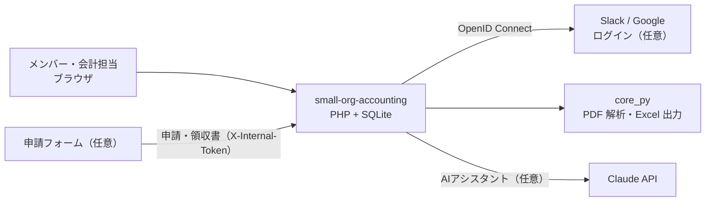

<div align="center">

# small-org-accounting

**部活・サークル・小規模団体のための会計ソフト**
仕訳・決算書・銀行明細の取り込み・会費の振込確認・請求書

[](https://www.php.net/)
[](https://www.sqlite.org/)
[](https://www.python.org/)
[](LICENSE)

**[デモを見る](https://haru-sudo.github.io/small-org-accounting/)**（架空のサンプルデータ。ブラウザの中だけで動きます）

</div>

---

## 概要

PHP と SQLite で動く、ブラウザで使う会計ソフトです。データベースのサーバーは要らないので、PHP が動くレンタルサーバーに置くだけで使えます。

部活・サークル・同好会・PTA・小さな会社など、**会計担当が数人で、銀行口座が1つ**くらいの団体を想定しています。

> [!NOTE]
> 銀行明細 PDF の取り込みは、いまのところ **三井住友銀行の法人向けインターネットバンキング（Value Door / Web21）** の「入出金明細照会」の帳票 PDF だけに対応しています（[取り込みのやり方](docs/valuedoor-import.md)）。ほかの銀行の口座でも、取引を手で入力すれば使えます。
> クレジットカード明細 CSV は **三井住友カード（法人カード）** の形式に対応しています。

## 主な機能

| 機能 | 内容 | 既定 |
|---|---|:-:|
| **帳簿** | 仕訳帳・元帳・日記帳・資産残高・月別残高 | 常に有効 |
| **決算書** | 月別の収支表。期末残高は現金・口座ごとの内訳付き（立替金は含めない）。閲覧専用ユーザーには公開した月だけを見せる。PDF・Excel で出力。選んだ勘定科目だけの「別表」も付けられる | 常に有効 |
| **銀行明細の取り込み** | 銀行明細 PDF を取り込み、自動仕訳ルールで仕訳（[やり方](docs/valuedoor-import.md)） | 常に有効 |
| **クレカ明細の取り込み** | カード明細 CSV を取り込み、加盟店名で仕訳 | ON |
| **会費の請求と振込確認** | 請求シートを作り、振込名義カナ × 金額で入金を照合して自動仕訳 | ON |
| **請求書・見積書** | 作成して PDF で出力（差出人・振込先・角印は設定から） | ON |
| **交通費・立替申請** | 外部の申請フォーム（Slack ボットなど）から届く申請を承認・返金・仕訳 | OFF |
| **AIアシスタント** | Claude API を使ったチャット。過去の仕訳を手本に未登録の取引を仕訳するなど、画面でできることをほぼ頼める。変更は管理者が承認してから実行（Claude の APIキーが必要） | ON |
| **ログインと権限** | パスワード / Slack / Google から選べる。管理者・閲覧専用・アクセス不可の3段階と編集ログ | パスワード |

使わない機能は **設定 → 使う機能** で切れます。切った機能は、メニュー・設定・API・AIアシスタントのツールから消えます（データは消えません）。

## デモ

https://haru-sudo.github.io/small-org-accounting/ で、架空のテニスサークルのデータを使って画面を試せます。

- サーバーは使わず、ブラウザの中で API をまねて動かしています（`demo/demo.js`）。変更はそのブラウザにだけ保存され、画面上部の「最初の状態に戻す」で元に戻せます。
- 明細の取り込み・Excel 出力・設定の保存・Slack / Google のログインは、デモでは使えません。AIアシスタントは、サンプルのデータから作るお試しの返答になります（実際の Claude は呼びません）。
- `index.html` は `*.github.io` で開かれると自動でデモになるので、Settings → Pages の Source は「Deploy from a branch」（`main` / root）でも「GitHub Actions」（`.github/workflows/pages.yml`）でも動きます。

## 動作環境

- PHP 8.1 以上（PDO_SQLite・mbstring）
- Python 3 と `PyMuPDF`・`openpyxl`（銀行明細 PDF の解析と Excel 出力に使います。PHP の `shell_exec` が使える必要があります）
- Apache（`.htaccess` の `mod_rewrite`・`mod_headers`）
- AIアシスタントを使う場合: Composer の依存（`vendor/`）と Claude の APIキー

## はじめかた

### 手元で試す

```bash
git clone https://github.com/haru-sudo/small-org-accounting.git
```

```bash
cd small-org-accounting
```

```bash
pip install PyMuPDF openpyxl
```

```bash
php -S localhost:8000 dev/router.php
```

http://localhost:8000/ を開くと、最初に **管理者のアカウントを作る画面** が出ます。

### サーバーに置く

1. リポジトリの中身を、Web から見えるディレクトリ（例: `public_html/accounting/`）に置きます。
2. AIアシスタントを使う場合は、同じ場所で `composer install --no-dev` を実行します。
3. `data/` と `uploads/` は初回アクセスで自動的に作られます。PHP から書き込めるようにしてください（Web からは `.htaccess` で見えなくしてあります）。
4. ブラウザで開き、**すぐに** 初回セットアップで管理者を作ります（ユーザーが1人もいない間は、最初にアクセスした人が管理者を作れるため）。

`main` に push したら自動でサーバーへ反映したい場合は、[デプロイ](#デプロイgithub-actions)を参照してください。

### 最初にする設定

**設定** 画面で次を登録します。

1. **基本設定**: 団体名・会計年度の開始月（1〜12月のどこからでも）・明細の取込で普通預金に付ける補助科目
2. **使う機能**: 要らない機能を切る
3. **勘定科目**: 小さな団体でよく使う科目が最初から入っています。勘定科目の画面で自由に変えてください
4. **期首残高**: 年度の初めの残高
5. 必要に応じて **請求書の差出人**（振込先・角印）、**会費の種類**、**決算書の別表**

## ログイン方法

**設定 → ログイン方法** で、使う方法を選びます（複数可）。どの方法でも、**ユーザー管理に登録したメールアドレス** で権限を決めます。

| 方法 | 準備 |
|---|---|
| メールアドレスとパスワード | ユーザー管理で各ユーザーにパスワードを設定します。本人はログイン後に右上の「パスワード」ボタンから変えられます |
| Slack でログイン | [api.slack.com/apps](https://api.slack.com/apps) でアプリを作り、OpenID Connect のスコープ（`openid` `profile` `email`）と、設定画面に出る Redirect URL を登録します |
| Google でログイン | [Google Cloud Console](https://console.cloud.google.com/apis/credentials) で「OAuth クライアント ID（ウェブ アプリケーション）」を作り、設定画面に出るリダイレクト URI を登録します |

- パスワードは10文字以上です。同じメールアドレスで5回（同じ IP から20回）続けて失敗すると、15分ログインできなくなります。
- Slack・Google のログインは、ユーザー管理に登録していない人も通ってきます。一覧にない人の扱いは既定で **アクセス不可** です（ユーザー管理の画面で変えられます）。
- パスワードログインを切るときは、Slack・Google で自分がログインできることを先に確かめてください。

## 権限

| 権限 | できること |
|---|---|
| 管理者 | すべての画面と操作 |
| 閲覧専用 | 管理者が公開した月の決算書を見る・PDF で出力する（全月を公開した年度は Excel も）。AIアシスタントが有効なら、公開済みの決算書について質問できる |
| アクセス不可 | ログインできない |

管理者は右上の「閲覧専用として見る」で、閲覧専用の人に見える画面を確かめられます。

## 振込確認の照合ルール

- **対象期間:** 会費シートは対象月の1日〜（振込期限＋猶予日数）、その他の請求は判定開始日〜（同）
- **照合条件:** 金額が一致し、振込名義にメンバーのカナが含まれる入金（全角 / 半角・ひらがな・小書き文字・空白の違いは吸収）
- 1つの入金は1人にしか割り当てません。姓だけの名義は、同じ金額のメンバーの中で1人に決まるときだけ使います。
- ほかの請求シートや申請（返金）に紐付いた入金は使いません。
- 照合した入金はメンバーごとに記録し、再チェックしても仕訳し直しません。
- 現金で受け取ったときなどは、詳細画面（または AIアシスタント）から **手動で振込済み** にできます。

## AIアシスタント

最初から有効になっています（使わない場合は **設定 → 使う機能** で切れます）。**設定 → AIアシスタント連携** に [Claude Console](https://platform.claude.com/settings/keys) で発行した APIキーを登録します（従量課金です。1人1日の回数の上限を設定できます）。

- 管理者は、ユーザー管理と秘密の設定を除くほぼすべての操作を頼めます。帳簿を変える操作は、実行する前に管理者の承認を求めます。
- 閲覧専用ユーザーは、公開済みの決算書と勘定科目についてだけ質問できます（変更系のツールはサーバー側で拒否します）。
- APIキーはサーバーの `data/master.db` にだけ保存し、画面には末尾4桁しか返しません。
- **Slack チャンネル参照**（任意）を有効にすると、Bot Token で指定したチャンネルを読み、カード明細などの目的を摘要に入れます（読むだけで、書き込みはしません）。

## 交通費・立替申請（任意・外部連携）

申請を受け付けるフォーム（Slack のモーダル、Google フォームを中継するスクリプトなど）は、このリポジトリには含まれていません。フォームから次の API を呼び出してください。

**設定 → 申請フォーム連携** で内部トークンを作り、リクエストの `X-Internal-Token` ヘッダーに付けます（トークンが未設定だと受け付けません）。

| メソッド | パス | 内容 |
|---|---|---|
| `POST` | `/api/claims` | 申請を作る（JSON） |
| `POST` | `/api/claim-receipt/{id}` | 領収書を添付する（multipart、フィールド名 `receipt`） |
| `GET` | `/api/transport-deadlines?month=YYYY-MM` | その月が締め切り済みか（`closed`）。トークン不要 |

`POST /api/claims` の主な項目:

```json
{
  "id": "フォーム側で採番した ID（任意。英数字とハイフン8〜64文字）",
  "type": "transport または advance",
  "applicant": "申請者の氏名",
  "person_kana": "振込名義のカナ（返金の照合に使う）",
  "amount": 1200,
  "application_date": "2026/04/10",
  "work_date": "2026/04/09（交通費）",
  "work_destination": "行き先（交通費）",
  "from_station": "出発（交通費）",
  "to_station": "到着（交通費）",
  "description": "内容（立替）",
  "memo": "メモ"
}
```

## システム構成



## ディレクトリ構成

```
.
├── index.html           画面（SPA）
├── auth.php             ログイン（パスワード・Slack・Google）・ユーザー管理・編集ログ API
├── api/router.php       JSON API（/api/...。.htaccess で振り分け）
├── core/
│   ├── helpers.php      SQLite のデータ層・機能の ON/OFF
│   ├── accounting.php   会計ロジック（決算・ルール・申請照合・カナ照合・初期の勘定科目）
│   ├── operations.php   画面と AIアシスタントで共用する操作（PDF/CSV 取込・期間リセット・振込確認・申請の仕訳・Excel）
│   ├── auth_roles.php   権限・セッション・CSRF・パスワード・ログイン失敗の回数制限
│   ├── ai_chat.php      AIアシスタント（Claude API の呼び出し・仕訳のツール・会話の保存）
│   ├── ai_tools_app.php AIアシスタントがアプリのほかの機能を扱うツール
│   ├── ai_files.php     AIアシスタントの添付ファイルと出力ファイル
│   ├── ai_examples.php  過去の仕訳から似た例を探す
│   ├── ai_approval.php  承認画面に出す「変更前 → 変更後」
│   └── ai_slack.php     Slack のチャンネルを読む（Bot Token・読むだけ）
├── core_py/             PDF 解析・Excel 出力（Python。PHP から呼び出す）
├── static/              CSS・JS・画像
├── dev/router.php       手元で動かすための PHP 組み込みサーバー用ルーター
├── demo/                GitHub Pages のデモ（ブラウザの中で API をまねる demo.js と、ビルドする build.sh）
├── docs/                取り込み手順などのドキュメント
├── data/                SQLite データベース（自動で作られる。リポジトリに含めない）
└── uploads/             領収書・取り込み中の PDF（同上）
```

`data/`・`uploads/`・`core*/`・`vendor/`・`dev/` は `.htaccess` で Web から直接見えないようにしています。領収書は認証付きの `/api/receipt/...` 経由で表示します。

## デプロイ（GitHub Actions）

`.github/workflows/deploy.yml` は、SSH + rsync でサーバーへ反映します。リポジトリの **Settings → Secrets and variables → Actions** に次を登録すると、`main` への push で動きます（登録していなければ何もしません）。

| 種類 | 名前 |
|---|---|
| Secrets | `DEPLOY_HOST`・`DEPLOY_USER`・`DEPLOY_SSH_KEY` |
| Variables | `DEPLOY_PATH`（例: `/home/xxxx/example.com/public_html/accounting`）・`DEPLOY_PORT`（任意。既定 22。Xserver は 10022） |

- 変更の判定はファイルの内容（チェックサム）で行います。
- `.gitignore` にあるもの（`data/`・`uploads/` など）は転送せず、サーバー上のものを残します。
- それ以外で GitHub に無いファイルは、サーバーから削除されます（`--delete`）。
- Actions タブから手動実行（`dry_run`）すると、何が変わるかだけを確認できます。

## データのバックアップ

すべてのデータは `data/` の SQLite ファイルと `uploads/` にあります。定期的にこの2つをコピーしてください。

## 貢献

Issue・Pull Request を歓迎します。ほかの銀行・カード会社の明細形式への対応は特に歓迎です（`core_py/pdf_parser.py`、`core/operations.php` の `opImportCreditCsv`）。

- 始める前に [貢献のしかた](.github/CONTRIBUTING.md) を読んでください。Issue はテンプレート（不具合・要望・明細形式・質問）から作れます。
- Pull Request は、メンテナーが承認したものだけをマージします（自動ではマージされません）。
- 脆弱性は公開の Issue にせず、[セキュリティ](.github/SECURITY.md) の方法で非公開で知らせてください。

## ライセンス

Copyright (C) 2026 HAL-JP

このソフトは [GNU Affero General Public License v3.0](LICENSE)（AGPL-3.0-or-later）で公開しています。

- 自分たちのサーバーに置いて使うだけなら、改造していても特にやることはありません。
- 配布するとき、または改造したものを Web で他の人に使わせるときは、その人たちがソースコード（改造した部分を含む）を入手できるようにし、同じ AGPL で公開してください。著作権表示とライセンスの表示も残してください。
- 画面のサイドバーとログイン画面の下にある「ソースコード」のリンクは、改造した場合はそのソースコードの場所に変えてください。
- 保証はありません。詳しくは [LICENSE](LICENSE) を読んでください。

「三井住友銀行」「Value Door」「三井住友カード」「Slack」「Google」「Claude」は、それぞれの権利者の商標または登録商標です。このソフトはそれらの会社とは関係がなく、公認・提携を受けたものではありません。
