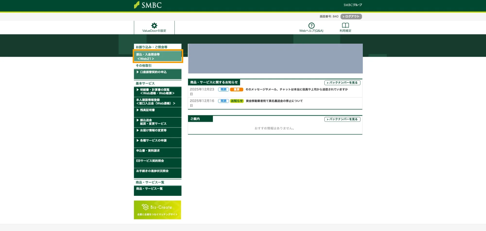
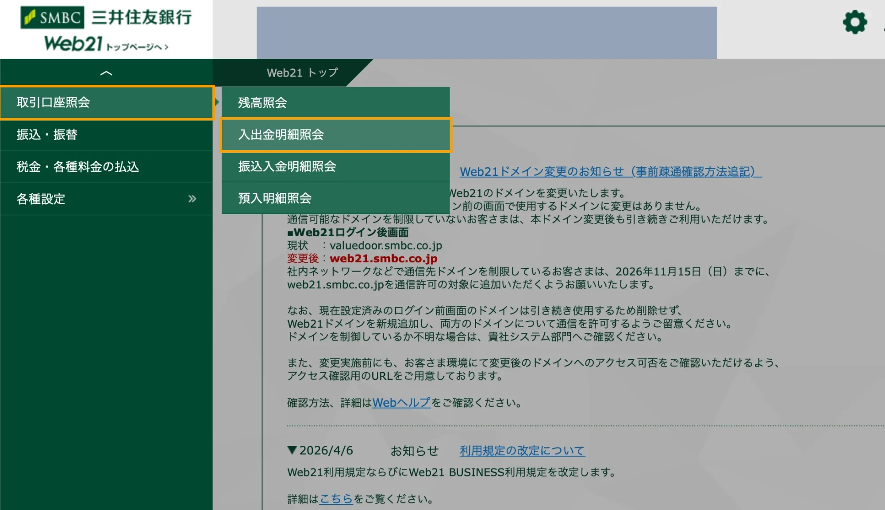
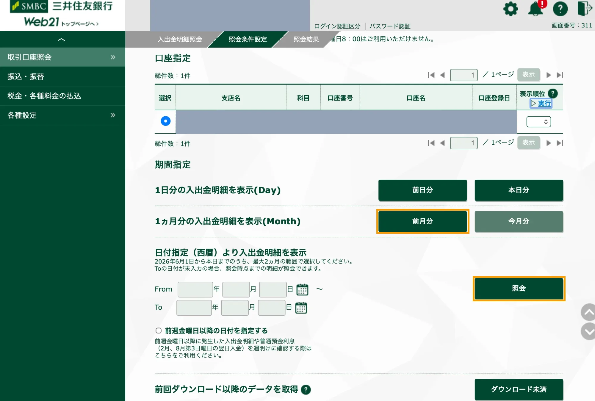
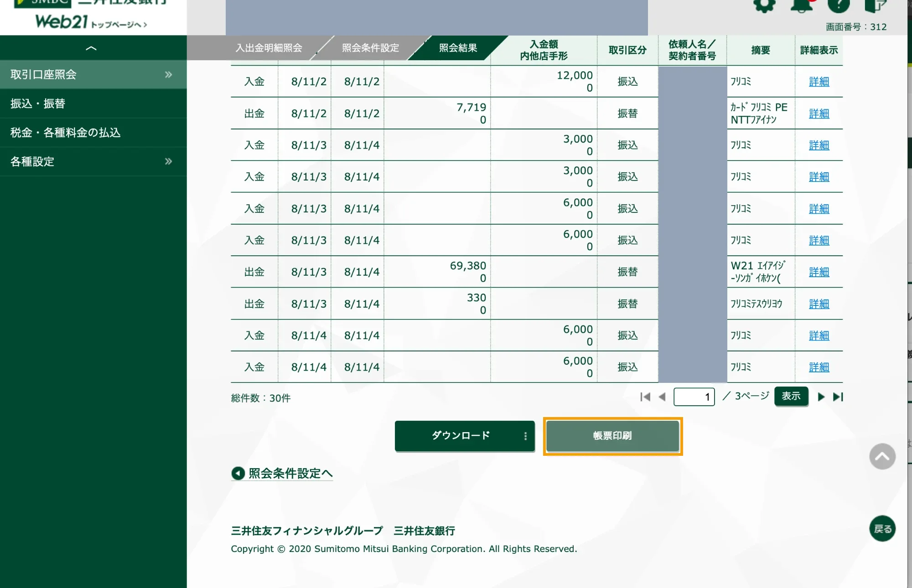

# 三井住友銀行（Value Door / Web21）の明細を取り込む

三井住友銀行の法人向けインターネットバンキング **Value Door** から「入出金明細照会」の帳票 PDF を保存し、このソフトに取り込む手順です。

> [!NOTE]
> 画面は2026年11月時点のものです。銀行側の画面が変わったら、Issue で知らせてください。

## 1. Value Door から Web21 を開く

Value Door にログインし、左のメニューの **「振込・入金照会等＜Web21＞」** を押します。

## 2. 入出金明細照会を開く

Web21 の左のメニューで **「取引口座照会」** にカーソルを合わせ、**「入出金明細照会」** を押します。

## 3. 口座と期間を選んで照会する

口座を選び、期間を指定します。

- 月ごとに取り込むなら **「前月分」** が簡単です。
- 期間を自分で決めるときは、「日付指定（西暦）」に From・To を入れて **「照会」** を押します（1回で照会できるのは最大2か月です）。

> [!IMPORTANT]
> **今日の分は含めないでください。** 取り込んだ期間の日付は「取込済み」になり、同じ日の取引はあとから取り込み直しても追加されません。今日の入出金はまだ増える可能性があるので、期間の終わりは前日までにします。

## 4. 帳票印刷で PDF を保存する

照会結果の画面で **「帳票印刷」** を押すと、明細の PDF が開きます。ファイルとして保存してください。

- 照会結果が複数ページに分かれていても、帳票 PDF にはすべての明細が入ります。
- 「ダウンロード」（CSV など）ではなく、**「帳票印刷」** の PDF を使います。

## 5. このソフトに取り込む

1. このソフトの **PDFアップロード** を開きます。
2. **取引期間 開始日・終了日** に、手順3で照会した期間を入れます（例: 前月分なら前月の1日〜末日）。
3. 保存した PDF をドロップする（またはクリックして選ぶ）と、取り込みが始まります。

取り込んだ取引は仕訳帳に「未登録」として入ります。

- **自動仕訳ルール** に合う取引（相手先・摘要の文字で判定）は、科目が自動で入って登録済みになります。
- 会費の **振込確認** は、取り込んだ入金を使って照合します（請求シートの画面で「振込確認チェック」）。
- 普通預金の側には、**設定 → 基本設定 → 銀行口座の補助科目** に入れた補助科目が付きます。

### 取り込み直したいとき

期間を間違えたときなどは、PDFアップロードの画面の下にある **「期間を指定してリセット」** で、その期間の仕訳を消して「未取込」に戻してから、もう一度取り込みます（リセットは取り消せます）。

## うまく取り込めないとき

| 症状 | 確かめること |
|---|---|
| 「PDFパースに失敗しました」と出る | 「帳票印刷」の PDF か（画面のスクリーンショットや、ブラウザの「印刷 → PDF」ではないか） |
| 0件と出る | 取引期間が PDF の照会期間と合っているか。その日付がすでに「取込済み」になっていないか（取込済み日付カレンダーで確認） |
| サーバーで Python のエラーが出る | サーバーに Python 3 と `PyMuPDF` が入っているか、PHP の `shell_exec` が使えるか |
